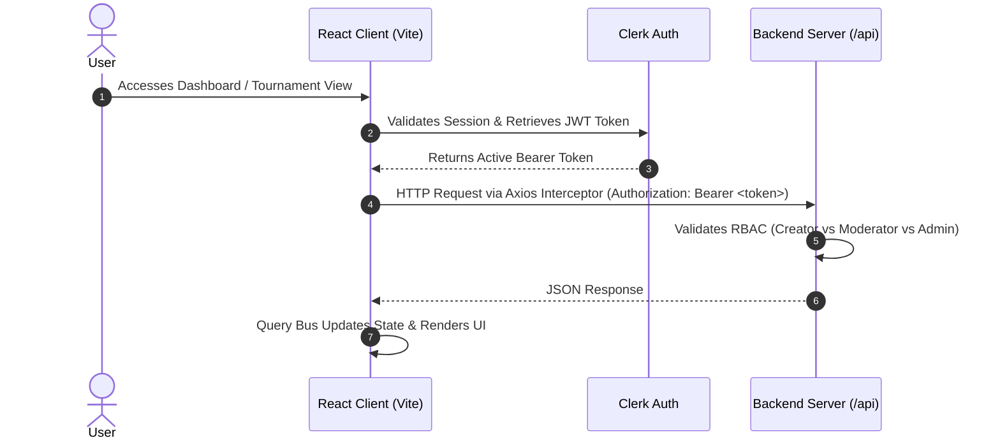

# TourneyHub — Esports Tournament & Bracket Platform

TourneyHub is a high-performance web platform built for competitive gaming communities, esports organizers, and players. It provides full lifecycle tournament management, role-based moderation, participant registration, and dynamic bracket orchestration.

---

## Architecture Overview

The codebase is organized using a **feature-first, domain-driven structure**, separating user interface primitives, global layout shells, API services, and domain business logic:

```
src/
├── components/
│   └── ui/                     # Reusable Shadcn UI primitives (Button, Calendar, Tabs, etc.)
│       ├── date-time-picker.tsx # Controlled Date & Time picker (react-day-picker v10)
│       ├── calendar.tsx        # Styled 7-column CSS grid calendar
│       ├── loading-screen.tsx  # Cyber/esports loading screen with tactical HUD telemetry
│       ├── toast.tsx           # Radix UI toast primitives
│       └── toaster.tsx         # Shadcn toast container
├── features/                   # Domain-driven feature slices
│   ├── admin/                  # Platform operator console
│   ├── landing/                # Public landing page, hero, live showcase grid
│   ├── profile/                # User dashboard, profile editor, hosted tournament roster
│   └── tournaments/            # Tournament discovery, creation & coordinator views
│       ├── TournamentDetail.tsx
│       ├── TournamentExplorer.tsx
│       ├── CreateTournamentForm.tsx
│       ├── TournamentManage.tsx # Coordinator container
│       └── manage/             # Decomposed tabs for reusability & modularity
│           ├── TournamentSettingsTab.tsx
│           ├── TournamentModeratorsTab.tsx
│           └── TournamentDangerTab.tsx
├── guards/                     # Authentication & role route wrappers (Clerk)
│   ├── RequireAuth.tsx
│   └── RequirePlatformAdmin.tsx
├── hooks/                      # Custom React hooks
│   ├── use-toast.ts            # Shadcn toast dispatcher & useToast hook
│   └── useTournaments.ts       # Native Axios query & mutation hooks with query bus invalidation
├── layouts/                    # Application shells
│   ├── RootLayout.tsx          # Public navigation & footer shell
│   └── DashboardLayout.tsx     # Authenticated sidebar navigation & user profile
├── lib/
│   ├── api.ts                  # Axios client with automated Clerk JWT interceptor
│   ├── tournament-data.ts      # Domain TypeScript contracts and status badges
│   └── utils.ts                # Tailwind CSS class merging utilities
├── services/
│   └── api.service.ts          # Typed REST API service methods
└── stores/
    └── bracketStore.ts         # Zustand bracket state management
```

---

## Key Features

### 1. Role-Based Access Control (RBAC) & Moderation
- **Tournament Creator (Admin)**: Full administrative authority to update tournament content, schedule, prize pool, assign/remove moderators, and delete the tournament.
- **Appointed Moderators**: Authorized platform users appointed by the creator to manage descriptions, rules, match outcomes, and schedules. Cannot appoint other moderators or delete tournaments.
- **Platform Admins**: Global override permissions managed via Clerk user metadata (`publicMetadata.role === "platform_admin"`).
- **Participants**: Can explore tournaments, register for open slots, and view live brackets.

### 2. Tournament Lifecycle Management
- **Draft (`DRAFT`)**: Staged tournament visible only to creator and moderators for configuration.
- **Registration Open (`REGISTRATION_OPEN`)**: Visible in public explorer; allows solo and team participants to enroll.
- **Ongoing (`ONGOING`)**: Matches in progress; brackets actively updating.
- **Completed (`COMPLETED`)**: Historical record of tournament results and winners.
- **Cancelled (`CANCELLED`)**: Archived or terminated tournaments.

### 3. Dynamic Formats & Configurations
- **Supported Formats**: Single Elimination, Double Elimination, Round Robin, Swiss.
- **Flexible Rosters**: Solo (1v1) or Squad-based (5v5, 3v3) with slot caps.
- **Prize Pools & Rules**: Customizable reward allocations and rulebooks.

---

## Performance Optimizations & Architecture Modernization

### 1. Replaced `@tanstack/react-query` with Native Axios Reactive Hooks
- Built a lightweight reactive Axios query and mutation system in [src/hooks/useTournaments.ts](file:///d:/personal_projects/tournament-project/tournament-frontend/src/hooks/useTournaments.ts).
- Features an automated query bus (`invalidateQueries(prefix)`) that triggers immediate refetches whenever mutations (`create`, `update`, `delete`, `addModerator`, `removeModerator`) resolve.
- Completely removed `@tanstack/react-query` dependency, cutting bundle overhead while retaining clean `{ data, isLoading, error, refetch }` and `{ mutate, mutateAsync, isPending }` ergonomics.

### 2. Replaced `react-hot-toast` with Native Shadcn Toast
- Implemented native Shadcn Toast primitives ([src/components/ui/toast.tsx](file:///d:/personal_projects/tournament-project/tournament-frontend/src/components/ui/toast.tsx), [src/components/ui/toaster.tsx](file:///d:/personal_projects/tournament-project/tournament-frontend/src/components/ui/toaster.tsx), and [src/hooks/use-toast.ts](file:///d:/personal_projects/tournament-project/tournament-frontend/src/hooks/use-toast.ts)) using `@radix-ui/react-toast`.
- Enhanced with convenience methods (`toast.success()`, `toast.error()`, `toast.info()`) adhering to the dark cyberpunk/esports design palette (`lime`, `ember`, `destructive`).

### 3. Dedicated Cyber/Esports `LoadingScreen` Component
- Designed [src/components/ui/loading-screen.tsx](file:///d:/personal_projects/tournament-project/tournament-frontend/src/components/ui/loading-screen.tsx) featuring:
  - Tactical HUD corner accents (`SYS.NODE // 01`, `PROTOCOL: SECURE`).
  - Dual-pulse radar ring with a counter-rotating terminal shield.
  - Animated laser scanning beam with CSS shimmer keyframes.
  - Monospace telemetry and status messaging.
- Replaced all basic "Loading..." text and plain spinners across [App.tsx](file:///d:/personal_projects/tournament-project/tournament-frontend/src/App.tsx), [TournamentExplorer.tsx](file:///d:/personal_projects/tournament-project/tournament-frontend/src/features/tournaments/TournamentExplorer.tsx), [TournamentDetail.tsx](file:///d:/personal_projects/tournament-project/tournament-frontend/src/features/tournaments/TournamentDetail.tsx), [TournamentManage.tsx](file:///d:/personal_projects/tournament-project/tournament-frontend/src/features/tournaments/TournamentManage.tsx), and [MyTournaments.tsx](file:///d:/personal_projects/tournament-project/tournament-frontend/src/features/profile/MyTournaments.tsx).

### 4. Route-Level Code Splitting (`React.lazy` + `Suspense`)
- Replaced eager imports with dynamic `lazy()` imports in [src/App.tsx](file:///d:/personal_projects/tournament-project/tournament-frontend/src/App.tsx), wrapped inside `<Suspense fallback={<LoadingScreen />}>`.
- Initial bundle size dropped by **~46%**, eliminating Vite's `> 500 kB` bundle warning.

### 5. Dependency Audit & Unused Package Removal
- Uninstalled 8 unused or redundant packages:
  - `@tanstack/react-query`
  - `react-hot-toast`
  - `@xyflow/react`
  - `@clerk/react` (redundant with `@clerk/clerk-react`)
  - `@hookform/resolvers`
  - `react-hook-form`
  - `zod`
  - `@radix-ui/react-dropdown-menu`

---

## Tech Stack

| Layer | Technology | Purpose |
| :--- | :--- | :--- |
| **Framework** | [React 19](https://react.dev/) + [Vite 6](https://vitejs.dev/) | Modern UI library with sub-second HMR and Rollup production builds |
| **Language** | [TypeScript 5.8](https://www.typescriptlang.org/) | Strict type safety across components, queries, and APIs |
| **Styling** | [Tailwind CSS v4](https://tailwindcss.com/) | Theme-based utility styling with dark mode and cyber/esports tokens |
| **Typography** | [Geist Sans & Geist Mono](https://vercel.com/font) | High-legibility technical typography loaded via Google Fonts |
| **Authentication** | [@clerk/clerk-react](https://clerk.com/) | Secure OAuth, user management, JWT session headers |
| **HTTP Client & Hooks**| [Axios](https://axios-http.com/) + Custom React Hooks | Reactive query bus with automated JWT injection & cache invalidation |
| **UI Components** | [Radix UI](https://www.radix-ui.com/) + Shadcn primitives | Accessible dialogs, popovers, select dropdowns, tabs, and toasts |
| **State Management**| [Zustand](https://zustand-demo.pmnd.rs/) | Lightweight global stores for brackets and application state |
| **Icons** | [Lucide React](https://lucide.dev/) | Consistent iconography across actions and telemetry |

---

## Getting Started

### Prerequisites
- Node.js 18.0.0 or higher
- npm, yarn, or pnpm

### Environment Configuration
Create a `.env` file in the project root:

```env
# Clerk Authentication Publishable Key
VITE_CLERK_PUBLISHABLE_KEY=pk_test_...

# Backend API Endpoint
VITE_API_BASE_URL=http://localhost:3001/api

# Public Landing Visibility (set 'false' to redirect to /dashboard)
VITE_SHOW_LANDING=true
```

### Installation & Development

```bash
# 1. Install dependencies
npm install

# 2. Start local development server
npm run dev

# 3. Check TypeScript types
npx tsc --noEmit

# 4. Run Oxlint fast linter
npm run lint

# 5. Build optimized production bundle
npm run build
```

---

## API & Authentication Flow



1. **Automatic JWT Injection**: [src/lib/api.ts](file:///d:/personal_projects/tournament-project/tournament-frontend/src/lib/api.ts) contains an Axios request interceptor that retrieves the Clerk session token via `window.Clerk.session.getToken()` and attaches it to every outgoing HTTP request header.
2. **Query Bus Invalidation**: Mutations in [src/hooks/useTournaments.ts](file:///d:/personal_projects/tournament-project/tournament-frontend/src/hooks/useTournaments.ts) automatically call `invalidateQueries('prefix')`, refetching active tournament, participant, and user queries.
3. **Shadcn Toast Feedback**: Network responses trigger contextual notifications using Shadcn's `@radix-ui/react-toast` primitives.
